# TP5 : Invocation de méthodes sur des objets distants avec Java RMI

**Activité 5-1 : Service de conversion de devise**

- Étudiante : Rihab Tarchi
- Matière : Développement d'applications réparties
- Faculté des Sciences de Sfax, LSI 3, 2026-2027

## Objectif

Concevoir une application répartie qui convertit un montant en euros vers le dinar tunisien avec Java RMI.

## Étape 1 : Développement du serveur

Projet `RMIConversion_Server` contenant : 
- `rmiService/IConversion` : interface distante
- `rmiService/ConversionImpl` : implémentation du service
- `rmiServer/ConversionServer` : démarre le registre RMI et publie l'objet

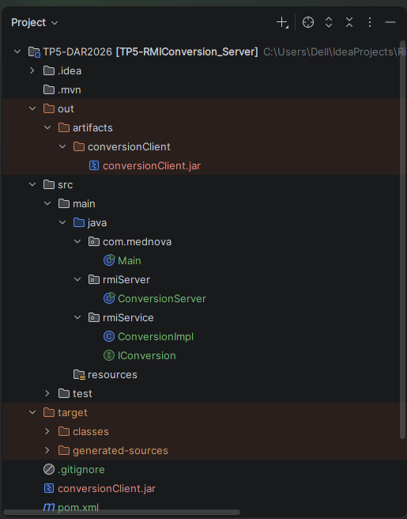
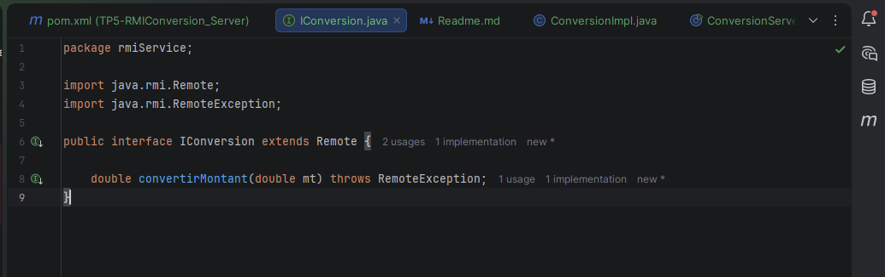
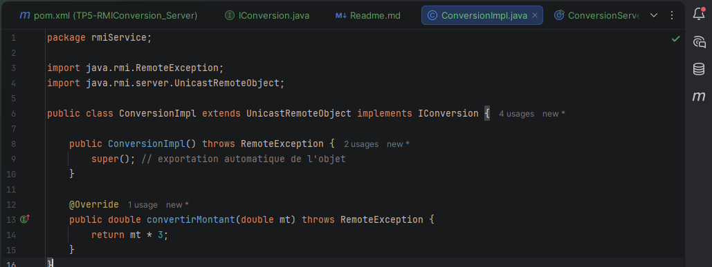
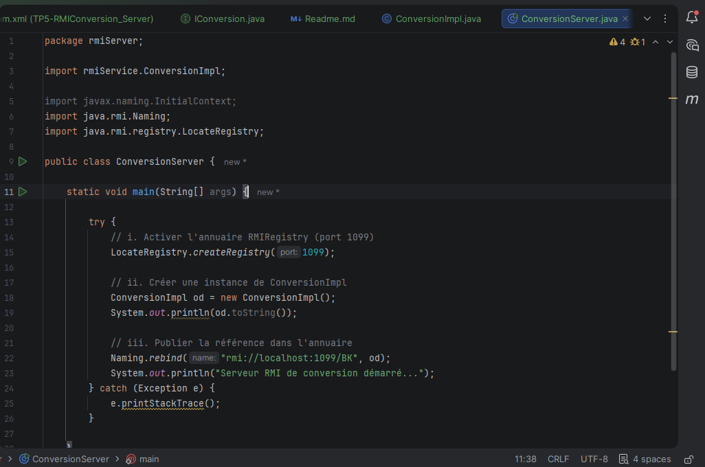

## Étape 2 : Développement du client

Génération de `conversionClient.jar` (interface seulement), ajout au classpath, puis création de `rmiClient/ConversionClient`.

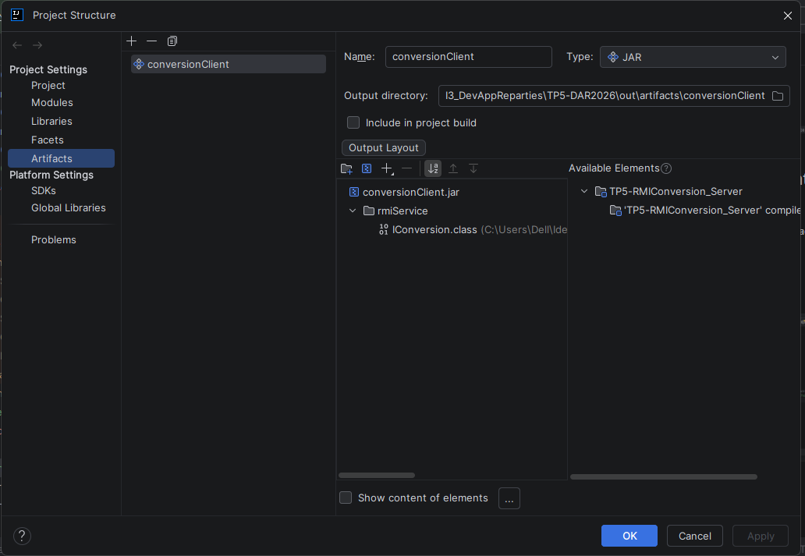

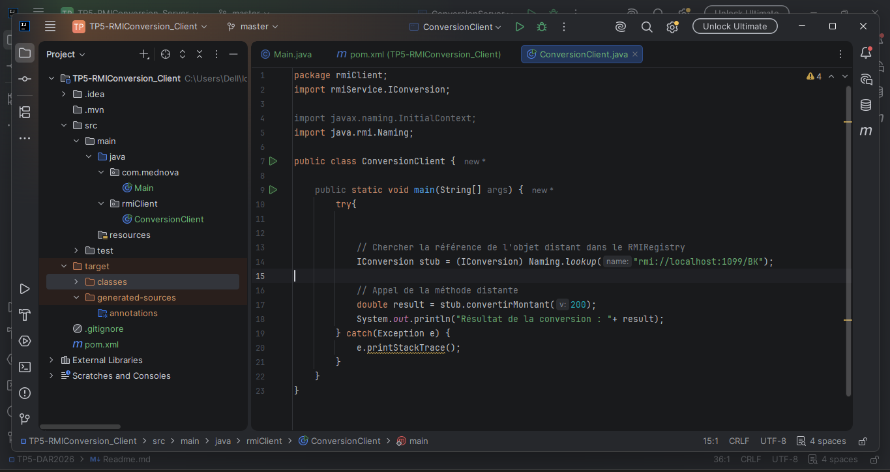

## Étape 3 : Exécution

Lancement du serveur, puis du client.

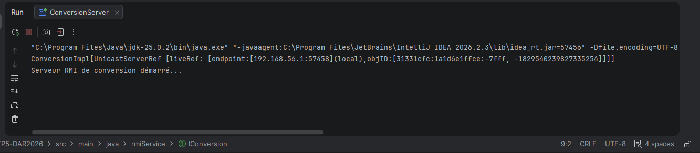
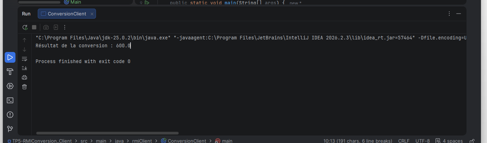

## Synthèse

RMI permet au client d'appeler une méthode d'un objet situé sur une autre JVM comme s'il était local, grâce au stub. Le cycle de vie d'un service distant comprend : la définition de l'interface (`IConversion`), l'implémentation (`ConversionImpl`), l'enregistrement dans le RMIRegistry (`rebind`) et l'invocation par le client (`lookup` puis appel de `convertirMontant`). Le client ne connaît que l'interface, pas l'implémentation.

## Activité 5-2 : Service de banque (RMI + JNDI)

- `Activite5-2/Server/` : serveur (`Compte`, `IBanque`, `BanqueImpl`, `BanqueServer`)
- `Activite5-2/Client/` : client (`BanqueClient`)

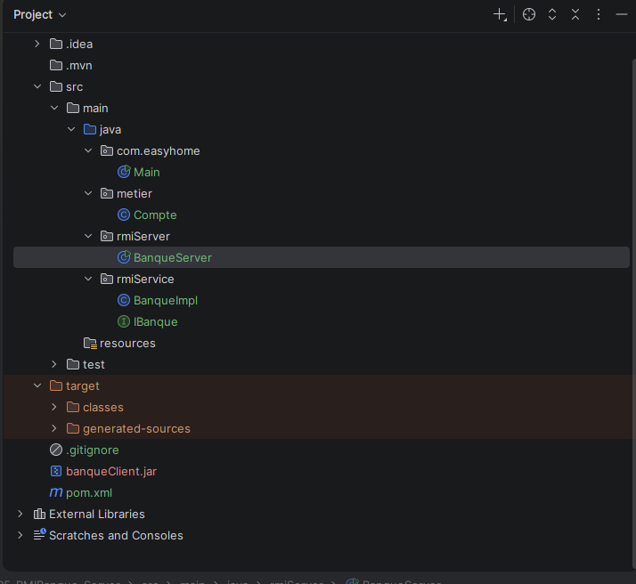
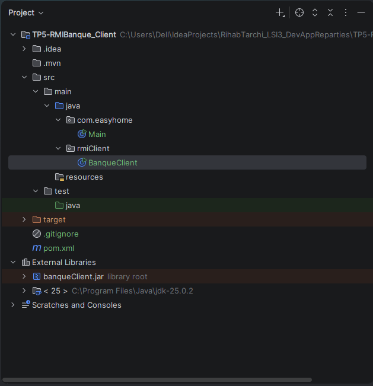
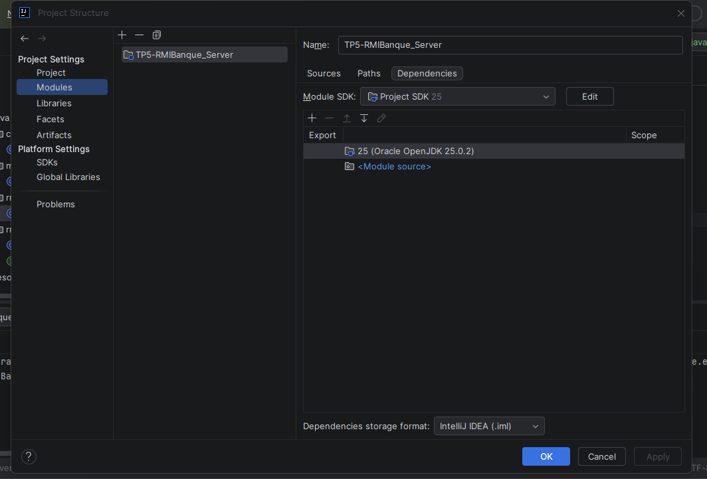
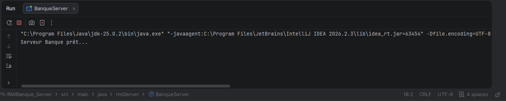
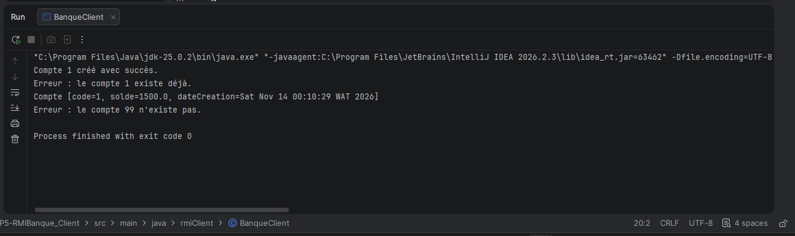
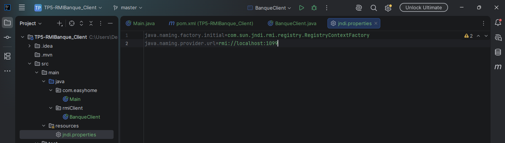
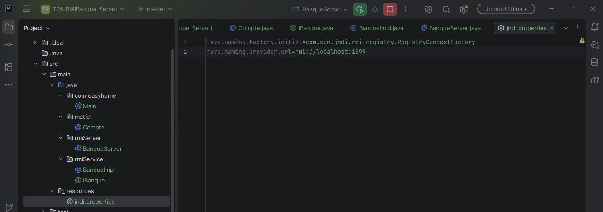
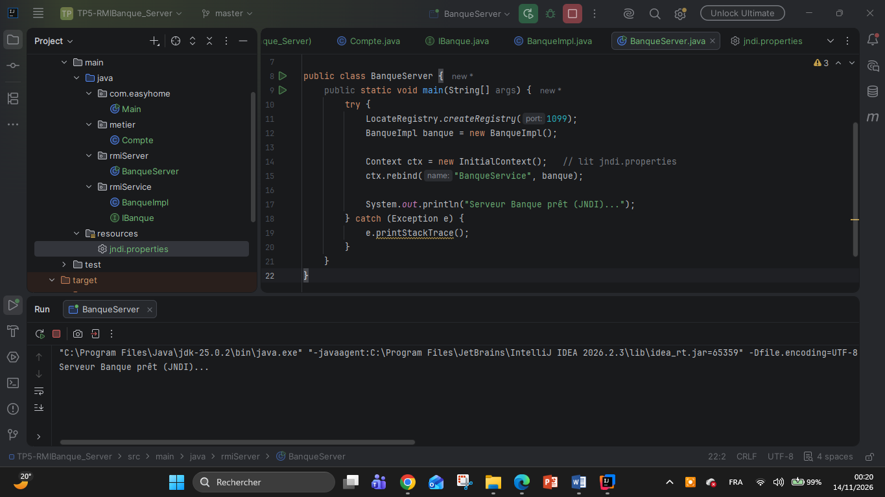
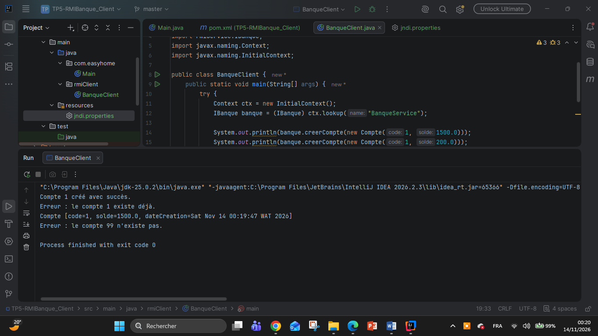
### Synthèse

RMI permet d'invoquer des méthodes sur un objet distant comme s'il était local, grâce au stub côté client. L'objet `Compte` passé en paramètre est sérialisé : il doit donc implémenter `Serializable`. JNDI ajoute une couche d'abstraction : le code ne dépend plus de `LocateRegistry` et `Naming`, et on peut changer d'annuaire en modifiant seulement `jndi.properties`.
